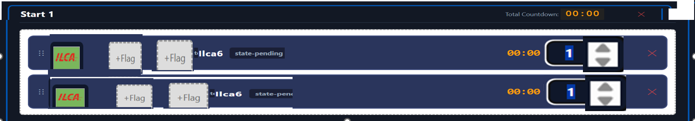

***Bug fixes and new features

**PROCESS RULE (agreed 2026-10-15): a bug only moves to resolved after a confirmed HUMAN browser
test. Passing regression scripts alone is not enough.

**Bugs

=================

Hot fix list

1) Note the RO and scorers tend to be retired sailors so the screns need to be simple as possible with least noise. The drag and drop flags, time settigns need to be large. Set defalut times to 1 in start events. on Race officer control panele: tighten up and create more space and bette readability for a greater numebr of start sequences. The ordder after the lap count must be asc. Include adding option for a 3rd flag, Flag oxes larger on the sailor . Make the lap counters and finishing more compacts, we may have 10-20 boats on the list, suggested 
20 incorrect previous bug, on the finish sheet, the order of sailors must start with Lap Count asc, so once a sailor complets the lap they move to the bottom of the list, the person doing scoring is
== CODED 2026-10-16, awaiting human test per process rule (Ctrl+F5 first - JS is cached). Applied:
row default time 1 min (app.py flag library default), RO panel tightened (cell padding reduced,
flag/text sizes kept, grids stay FULL-WIDTH VERTICAL stacking per RO feedback 2026-10-16 -
side-by-side columns lost space with 3-4 start sequences),
add-start button fixed bottom-right with the same rounded style as the other buttons, active
countdown border halved, active row timer no longer blows up to 25vw font), 3rd flag slot per row
(class-start + finish-sheet columns recognise all three slots), finish sheet compact one-line
sailor rows (class flag on the card, sail number prominent and right-aligned next to the lap
counter, smaller finish box, ~44px rows), lap-count ASC ordering (completing a lap moves the
sailor down; finished sailors stay at the bottom by finish time). Registry sidebar: sailors
checked to race drop to the bottom of the registry list so sailors still to sign on stay at
the top; the chosen sort order applies within each group (CODED 2026-10-16, awaiting human
test). Regression scripts all pass;
frontend changes need the human browser test.

==================
resolved

1 the sailors selected in the register dont land in the correct finish class, the count down has 
three seperate starts with class flags, this should sort/goup the sailor register into 3 matching
 class, any unmathed will automaticall be in the 'open class' == fixed ✅
2 when click the clear sailor resitry - do  not display a warning - low risk of information loss,
 easy to recover from a user mistake == fixed ✅
3 csv export fails == fixed ✅

10 the sailor register sort by class no longer sorts == passed ✅ fixed (Sort by Class option was missing from the dropdown; added option + sort logic, secondary sort by name)
11 finish sheet start numbers now match the race officer grid numbers == passed ✅ fixed (grid renumbering updated the page headers but not the rows' grid_index, so class-start reported stale numbers; rows are now re-pointed when grids are removed/renumbered)
12 open category finish sheet did not activate == Passed ✅ human test FAILED 2026-10-15 (backend was fixed
and passed regression tests, but the human test showed Open Category cards never activate).
Test scenario: Start 1 = Ilca 6 + Ilca 7 (Anton, Bridget - worked correctly, own columns, lapped
fine). Start 2 = pclass flag. Victoria (P Class) OK. Emma (Starling, no flag in sequence = Open
Category) - her column never activated when countdowns hit 0. Root cause found: finishsheet.js
pollClassStarts() re-disables every card whose class has not started on each poll, and Open
Category cards have no class_id, so they were permanently disabled even though the card was
created with buttons enabled. Fix applied: poller now treats open-category cards as started once
the race is running (race_id exists), and card creation only enables open-category buttons once
the race is active. NOTE: this is the same failure as bug 19. Regression scripts cannot catch
frontend bugs - awaiting confirmed human test (hard refresh Ctrl+F5 first, JS is cached).
BUSINESS RULE ADDED after clarifying the RO test setup (2026-10-15): the RO can drag the OPEN CLASS
flag (openclass.png) into a start event - the Open Category then activates ONLY when that start
event fires (e.g. open flag in Start 2 -> open activates at Start 2, not Start 1). Without an open
flag in the sequence, Open Category activates with the race's first start. Backend: class-start
recognises openclass.* (previously a silent 404 - no boat class behind it), open start stored in
app_state['open_start_time'], record-lap/mark-finish block open sailors until the open start fires,
race-status reports open_started/open_flag_in_sequence. Frontend: poller and card creation use
the backend-reported open_started. Regression: scripts/test_open_flag.py (all tests pass).
15a flag asset fix - Passed ✅ P Class flag updated pclass.jpg -> pclass.png (new 686x785 image; boat_classes now points at pclass.png; old pclass.jpg removed from static/flags so it no longer appears as a draggable card in the RO flag picker). P (blue peter, p.png) and P Class (pclass.png) are TWO DIFFERENT flags/classes - do not merge them. tempref/recording.jsonl references updated to pclass.png so the replay tool keeps working.
13 the stray 'nul' file that broke git commits == resolved 2026-10-16 (git-level, not a browser bug): file deleted (it is a reserved Windows device name - Explorer and plain 'del nul' silently fail; Git Bash 'rm' removed it) and 'drag-drop-app/nul' is already in .gitignore, so commits cannot break again even if it reappears. Likely cause: a '> nul' redirect run in a Git Bash session (MSYS creates a real file named nul; cmd treats nul as a device, so the .bat launchers are safe).
16 requirements: 2 classes in the same start sequence == resolved 2026-10-16: Requirements.md updated (secondary/tertiary flag slots + shared starts). The code already supported it - one class-start POST per start event carries ALL the grid's flags, and every recognised class gets its own finish-sheet column.

=============================
in progress

6 move the add start button on the RO page to the lower right == CODED 2026-10-16 (fixed
bottom-right, '+ Add Start', same rounded rectangle as the other buttons; index.html + style.css),
awaiting human test per process rule
7 gold/yellow active countdown border halved (4px -> 2px on RO rows; finish-sheet class-started
cards too) == CODED 2026-10-16, awaiting human test per process rule
8 start event boxes narrower / more start sequences visible == CODED 2026-10-16; human test
feedback same day: side-by-side columns REVERTED to full-width vertical stacking (RO: loses
space with 3-4 start sequences), compact paddings kept. Awaiting re-test per process rule
9 finish sailors compact == CODED 2026-10-16; AMENDED after human test same day: lap counter on
the LEFT, finish tick box on the FAR RIGHT (prevents accidental finish clicks), all fields on
one line (class flag, class, name, sail number), fonts/card +25%, lap button + finish box +40%.
Awaiting re-test per process rule

14 must allow a late sailor to be added to the race after it has started == regression + replay PASS (sailors signed on AFTER their class start stay visible in their own class column, live until first lap/finish, then join the locked roster race_sailors without duplicating. Regression: scripts/test_late_signon.py; replay of the 23:40 recorded session passes all 15 steps). Awaiting confirmed human test per process rule
21 The timers are not recording start time = expert results show:
Sequence	Class	Sailor	Sail No	Start Time	Laps	Lap Times	Finish Time	Race End Time
	Ilca 6	Anton	187893		1	2026-10-15T23:05:59.664573	2026-10-15T23:06:15.351890	2026-10-15T23:06:19.936983
	Ilca 6	Bridget	212958		1	2026-10-15T23:05:56.424181	2026-10-15T23:06:10.087931	2026-10-15T23:06:19.936983
	P Class	Victoria	177		1	2026-10-15T23:06:05.727660	2026-10-15T23:06:17.268994	2026-10-15T23:06:19.936983
	Starling	Emma	779		1	2026-10-15T23:06:04.032287	2026-10-15T23:06:13.304246	2026-10-15T23:06:19.936983
1	Ilca 7	John	214440	2026-10-15T23:04:52.983708	1	2026-10-15T23:06:02.381396	2026-10-15T23:06:11.737419	2026-10-15T23:06:19.936983
NOTE the start time and lap Times MUST be running on the total start sequence time, NOT the fist flag timer, 
check document in the start time there will be a sequence of flags, 
running ususally class flag for 1 minute, class flag plus P.png, for the second minute and dflag.png for the last minute.
ROOT CAUSES + FIXES (2026-10-15, awaiting human test per process rule):
a) RACE CONDITION (why start times were blank): when a start event had Ilca 6 + Ilca 7 flags,
both class-start POSTs fired simultaneously, both saw "no active race" and EACH created its own
race (races 48 + 49 in the DB) - class starts were split between the two races and the CSV
exported the wrong one. Fix: one class-start POST per start event with ALL the grid's flags,
and a server-side RACE_STATE_LOCK so race auto-creation and roster locking can never race.
b) START AT END OF FULL SEQUENCE (bug 17 included): class-start now fires only when the LAST
row of a start event completes (class flag -> +P -> D flag sequence all done), not when the
first sub-timer hits 00:00. Signal flags in the grid (Dflag, postpone...) are ignored by the
server. CORRECTION (RO, 2026-10-15): p.png is the blue peter SIGNAL flag (letter P, preparatory),
NOT the P Class racing flag - the P Class dinghy is a boat class with flag pclass.png
(Sailwave class name 'P Class'). Fixed: boat_classes class_id 5 'P' wrongly claimed p.png
(spurious row, zero sailors) - row DELETED along with 9 bogus class-5 race_class_starts rows
from old manual-backup test races (no P sailor ever raced); 'P': 'p.png' removed from
DEFAULT_FLAG_MAPPINGS in scripts/import_sailwave.py so a Sailwave refresh can never re-apply it.
NOTE: a Sailwave refresh with the OLD script re-applied p.png once before the row was deleted.
If a 'P' class row ever reappears in boat_classes, delete it - the import mapping is removed,
so a refresh cannot recreate it.
Regression: scripts/test_start_event.py now asserts p.png and Dflag are both skipped.
Regression: scripts/test_start_event.py (single race from concurrent starts, signal flags
skipped, CSV start times present).
HUMAN TEST 2026-10-15 23:44: Start 1 (Ilca 6, full 3-flag sequence) PASSED - start time
23:44:38 recorded for both Ilca 6 sailors, sequence 1 in CSV. ONE FAIL REMAINING: Open Category
sailors (Emma, Victoria sailing open) had blank Start Time + Sequence in the CSV.
c) FIX (2026-10-15): the open start was only stored in memory (app_state) and never persisted -
the CSV export joins on race_class_starts (class_id NOT NULL), so open sailors always exported
blank. New table race_open_starts (race_id UNIQUE, start_time, sequence_number): the openclass
flag start is persisted there when it fires, and the CSV export falls back to it for sailors
with no class start row (falls back to the race's earliest class start if no open flag was
used). Sequence number also falls back, so open sailors now show the open flag's start number.
Regression: scripts/test_open_flag.py 4b (open start row + start time + sequence in CSV).
Awaiting human re-test of the CSV export.

22 the sailor registry reset race did not clear the highlighted finish boxes and not ready for the next race of the day
== FIXED 2026-10-15, awaiting human test per process rule. Root cause: the registry sidebar Reset
button called /api/reset-finish-sheet, which wiped finish times in the DB and cleared the Flag
Machine sequence but left race_id set - so the UI skipped its re-render (gated on race not active)
and the green finished cards stayed on screen. New rule: reset-finish-sheet REFUSES while the
race is still running ("end the race first"); after the race is ended it clears the race state
(race_id, class start times, open start, end flags) so the sheet is READY for the next race of
the day, while keeping all recorded laps/finishes/race history in the DB and NEVER touching the
Flag Machine sequence. Frontend: the registry Reset button now always re-renders the sheet and
shows the server message on failure; the Start button re-enables once the sheet is READY.
Regression: scripts/test_start_event.py sections 4-6.
======================
active

4 the 2 end race buttons are not synched, 1 button on each page must stop all timers and chnage race status from running to ended
5 reset finish sheet does not reset anything - it should clear lap counts etc.

15 add the elapsed time per class for each finish sheet so the race officer will know when the max 
allowed time per race is approaching
17 the finish activates after the first sub timer, the finish sheet must be on the last subtimer in the start event == fixed with bug 21b: class-start now fires only when the LAST row of the start event completes; awaiting human test per process rule
18 if more than 4 strat events, then any remaining class defaults to open class even though it has a flag
19 the open class can not record results and laps == same root cause as bug 12 (finishsheet.js poller re-disabled open-category cards every poll); fix applied with bug 12, awaiting confirmed human test

 workign with the sailors at the top of the list as the approach lap completion. 

**New Freatures
1 save start sequence for easy set-up
2 disqualify the sailor 
3 dnf 
4 multi-station finish sheet (named stations) - 2 operators capture laps/finishes on separate
  screens (e.g. 4K 14in touchscreen + non-touch laptop). Currently done as 2 tabs of the same page
  with no coordination between them - the data layer is already safe (server-truth SQLite), the
  problems are coordination: double capture (both operators can click LAP/FINISH on the same sailor
  a second apart = double-counted lap), polling lag between tabs, and manual drag order being
  tab-local only (race_sailors.placement is never written, so the two screens silently disagree).
  Design:
  a) /finishsheet?station=1 / ?station=2 - station ID remembered per tab, shown as a badge
  b) server-side capture claims - short-TTL lock per sailor uid (heartbeat while a card is being
     touched); the other station dims the card ("station 1 capturing") - prevents double capture
  c) replace polling with Server-Sent Events so captures propagate to all stations sub-second
  d) persist manual drag placement to race_sailors.placement so both screens converge on one order
  e) optional: assign class columns to a station to divide the work between operators
  Deliberately NOT BroadcastChannel (tab-to-tab messaging only works same-machine; future
  scenarios - start boat, other devices/clubs - need the server-side version). Touch events are
  just clicks, so the touchscreen needs nothing special.

***Test Record/Replay (bug reproduction tool)

How to record a session:
1. In a browser open: http://localhost:5000/api/test/record?action=start
2. Click through the race-day flow exactly as when the bug occurred (build sequence,
   sign on sailors, start, laps, finishes, end race). Every API call your clicks
   produce is logged to tempref/recording.jsonl.
3. Stop recording: http://localhost:5000/api/test/record?action=stop

How to replay instantly (no countdown waits):

    C:\ProgramData\miniconda3\python.exe scripts/replay_race.py

The replay runs against a scratch copy of score.db (live data untouched) and fires
every recorded step back-to-back - class starts, laps and finishes all happen
immediately instead of waiting for the countdowns. Any step returning HTTP >= 400
is flagged FAIL with its request body - that is the minimal reproduction for the bug.
Options: --gap 0.2 (small pause between steps), --keep-db (keep scratch DB for inspection).

Note: recording stops if the server restarts (debug auto-reload) - start recording
after the pages are loaded, and record one bug session at a time.
